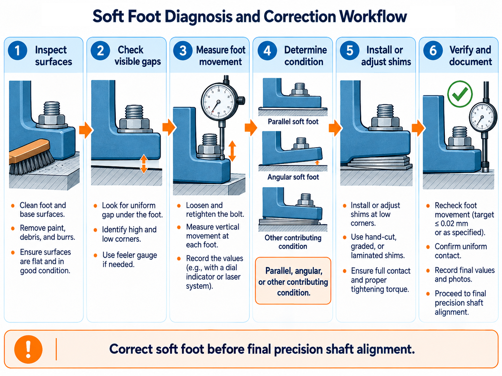
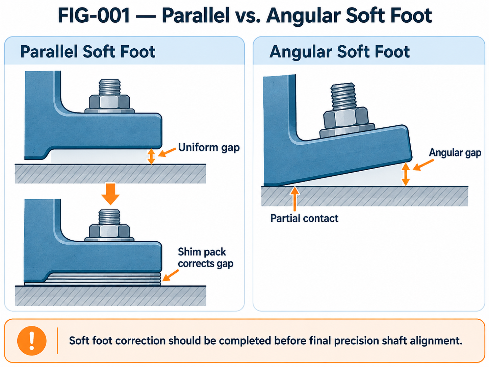
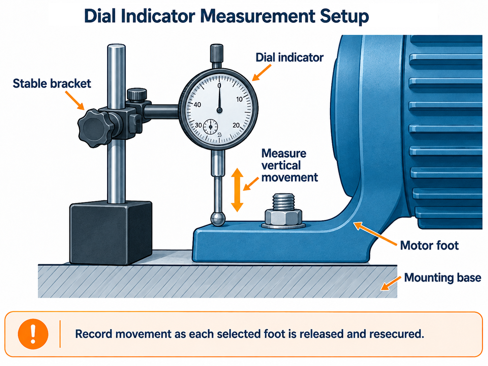
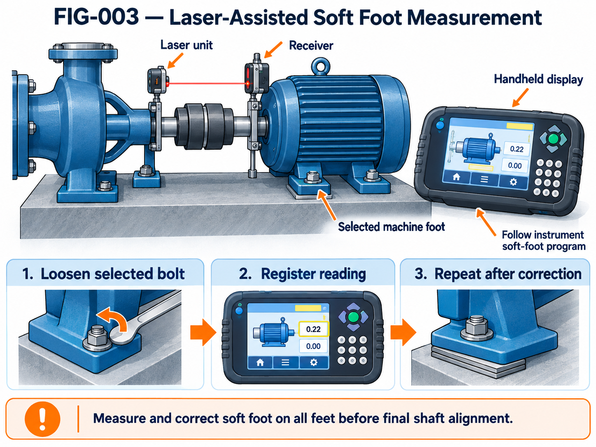
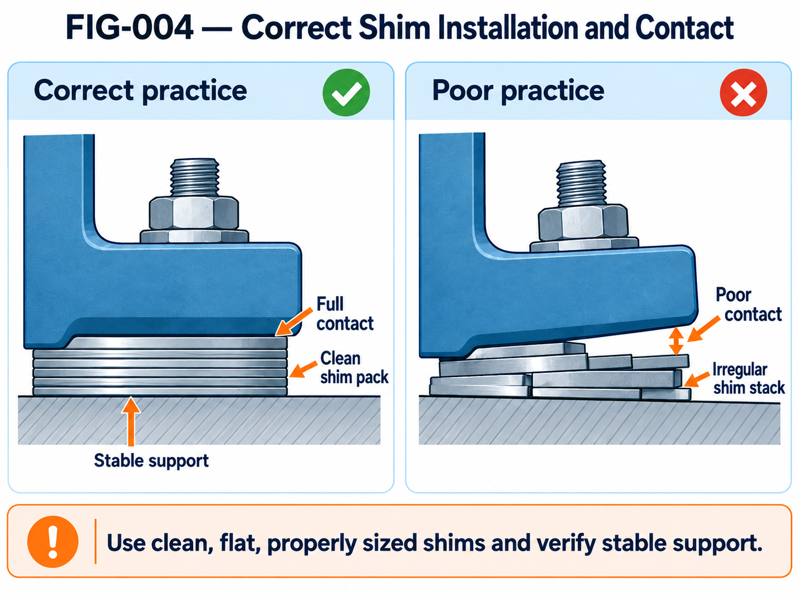

---
title: "SOP-001 | Motor Soft Foot Detection & Correction"
subtitle: "Applied Engineering Methodology for Rotating Machinery"
author: "Vicente Angulo"
date: "2026-10-17"
categories:
  - Mechanical Engineering
  - Precision Maintenance
  - Rotating Equipment
  - Applied Learning
description: "Engineering methods for identifying, measuring, correcting, and verifying motor soft foot."
toc: true
toc-depth: 3
number-sections: true
draft: false
---

::: {.callout-note}
## Document Control

**Document ID:** SOP-001

**Revision:** 0.1 — Technical Review Draft

**Document Type:** Independent Educational Engineering Procedure

**Prepared by:** Vicente Angulo

**Discipline:** Mechanical Engineering / Precision Maintenance

**Application:** Horizontal rotating machinery

**Technical Status:** Under review

This document presents an independent educational methodology developed from engineering knowledge and practical maintenance experience.

It is not a site-approved SOP, OEM instruction, or authorization to perform industrial work.
:::

# Purpose

Establish a structured engineering methodology for detecting, evaluating, correcting, and verifying soft foot conditions in horizontal rotating machinery.

The methodology focuses on:

- Mechanical inspection and surface preparation
- Identification of soft foot conditions
- Measurement using feeler gauges
- Measurement using dial indicators
- Laser-assisted soft foot evaluation
- Controlled shim installation
- Verification and documentation

{#fig-softfoot-workflow width="100%" fig-align="center"}

@fig-softfoot-workflow summarizes the overall sequence. The numeric threshold shown in the illustration is **not a universal acceptance criterion**. Use equipment-specific approved limits.

# Engineering Fundamentals

Soft foot is a condition in which one or more machine feet do not establish proper support on the mounting surface under the specified installation condition.

When hold-down bolts are tightened, inadequate support or uneven contact may introduce mechanical distortion.

Possible consequences include:

- Changes in shaft alignment
- Non-repeatable alignment measurements
- Distortion of machine feet or frame
- Additional structural loading
- Increased installation and correction effort

Soft foot correction should be completed before final precision shaft alignment.

## Parallel Soft Foot

Parallel soft foot occurs when a machine foot has a relatively uniform gap between its lower surface and the supporting structure.

Potential causes include:

- Missing or inadequate shims
- Uneven mounting elevations
- Improperly prepared mounting surfaces

The correction normally involves establishing appropriate support using clean, correctly dimensioned shim material.

## Angular Soft Foot

Angular soft foot occurs when the machine foot and mounting surface are not parallel.

Possible causes include:

- Twisted machine frame
- Uneven mounting pads
- Deformed machine feet
- Local surface irregularities

An angular condition requires investigation of contact geometry rather than automatically adding a uniform shim.

{#fig-softfoot-types width="90%" fig-align="center"}

@fig-softfoot-types distinguishes a relatively uniform gap from partial or angular contact. The drawing is conceptual and not to scale.

## Other Contributing Conditions

Soft-foot-like measurements may also arise from:

- Pipe or conduit strain
- Mechanical distortion
- Improper fastening practices
- Bent feet or damaged foundations
- Dirt, corrosion, paint, or burrs
- Measurement setup instability

These conditions should be investigated before selecting a corrective action.

# Safety and Preparation

Before performing inspection or adjustment:

1. Apply the applicable site-approved isolation and lockout/tagout procedure.
2. Verify the required zero-energy condition.
3. Control stored mechanical and electrical energy.
4. Establish safe access to the machinery.
5. Follow approved lifting and handling procedures when machine movement is required.
6. Confirm appropriate authorization and supervision.
7. Use tools suitable for the equipment and task.

Do not use this educational procedure as a substitute for workplace safety requirements.

# Mechanical Preparation

## Mounting Surface Inspection

Inspect motor feet, mounting pads, and supporting surfaces for:

- Burrs and raised edges
- Corrosion
- Paint accumulation
- Foreign materials
- Mechanical deformation
- Damaged or unstable shim packs

Remove contamination using methods approved for the component and installation.

Avoid removing structural material or changing mounting geometry without an engineering assessment.

## Fasteners and Adjustment System

Inspect:

- Hold-down bolts
- Threads and washers
- Jacking screws
- Mounting brackets
- Support structure

Use fasteners specified for the particular installation.

Fastener grade, dimensions, preload, and torque must follow applicable engineering documentation.

## Initial Contact Evaluation

Observe whether the machine rocks or exhibits uneven contact.

Document:

- Machine foot identification
- Existing shim configuration
- Visible gaps
- Mounting surface condition
- Initial fastening condition

Do not remove existing shim packs indiscriminately.

Preserve the initial configuration for evaluation.

# Required Measuring Equipment

| Instrument | Main Application |
|---|---|
| Feeler gauge | Gap identification |
| Dial indicator | Vertical foot displacement |
| Magnetic or rigid indicator mount | Stable measurement reference |
| Laser alignment system | Soft foot evaluation when supported |
| Precision straightedge | Contact and surface checks |
| Stainless-steel shim kit | Controlled correction |
| Caliper or micrometer | Shim thickness verification |
| Torque wrench | Specified fastening torque |

All equipment should be suitable for the required measurement range and accuracy.

# Detection Method A — Feeler Gauge

## Objective

Identify visible or measurable gaps between a machine foot and its supporting surface.

## General Method

1. Establish the approved safe condition.
2. Inspect the mounting interface.
3. Record the existing shim arrangement.
4. Evaluate the contact condition.
5. Use an appropriate feeler gauge to investigate accessible gaps.
6. Record the location and measured thickness.
7. Compare readings across the machine feet.
8. Identify potential parallel or angular conditions.

A localized gap does not necessarily describe the complete deformation of the machine.

## Interpretation

**Uniform gap:** Possible parallel soft foot.

**Wedge-shaped or partial gap:** Possible angular soft foot.

**Variable or inconsistent readings:** Investigate mechanical loading, fastening, and measurement repeatability.

# Detection Method B — Dial Indicator

## Objective

Observe movement at individual machine feet as specified hold-down fasteners are released and resecured.

{#fig-dial-softfoot width="90%" fig-align="center"}

@fig-dial-softfoot illustrates the instrument placement. Use a mechanically independent, stable reference.

## General Method

1. Mount the dial indicator on a stable reference.
2. Position the measuring tip to detect vertical movement of the selected machine foot.
3. Establish the approved initial fastening condition.
4. Zero the indicator.
5. Release the selected fastener according to the approved measurement procedure.
6. Record the indicated displacement.
7. Restore the specified fastening condition.
8. Repeat the measurement where necessary.
9. Evaluate the remaining feet systematically.

## Interpretation

Recorded movement can indicate insufficient support or installation distortion.

However, displacement measurements must be interpreted considering:

- Machine frame stiffness
- Bolt-loading sequence
- Indicator mounting stability
- External mechanical loads
- Repeatability of the measurement

A single reading should not automatically be treated as an exact required shim thickness.

# Detection Method C — Laser-Assisted Evaluation

## Instrument Preparation

When using an Easy-Laser E420 or another compatible alignment instrument:

1. Review the applicable instrument manual.
2. Inspect measuring units and mounting accessories.
3. Confirm equipment condition and calibration requirements.
4. Install brackets on suitable clean surfaces.
5. Confirm mechanical stability of the measurement arrangement.
6. Enter the required geometric dimensions.

{#fig-laser-softfoot width="90%" fig-align="center"}

@fig-laser-softfoot is a teaching illustration, not a reproduction of the Easy-Laser E420 interface. Example display numbers are illustrative, with no stated engineering units or acceptance status.

## Soft Foot Measurement

Access the instrument's supported soft foot measurement program.

Follow the manufacturer's documented sequence for measuring each machine foot.

Record:

- Foot identification
- Instrument reading
- Measurement units
- Fastening condition
- Repeatability observations

The reading may reflect elastic movement and mechanical loading, not simply an open gap.

## Verification

Repeat the measurement after correction.

Investigate substantial differences between successive readings before accepting the result.

Instrument-specific controls, measuring positions, and commands must be verified against the actual device manual.

# Shim Selection and Installation

## Engineering Requirements

Shim packs should provide stable, repeatable, and appropriate machine support.

Select materials and dimensions suitable for the installation.

Verify:

- Thickness
- Flatness
- Cleanliness
- Surface condition
- Foot coverage
- Proper seating

{#fig-shim-contact width="90%" fig-align="center"}

@fig-shim-contact compares correct contact principles with poor support. The illustrations are conceptual; evaluate actual shim thickness and contact using applicable specifications.

## Installation Principles

- Preserve the original shim record.
- Avoid damaged or burred shims.
- Minimize unnecessary stacking.
- Use suitable precut shim material.
- Ensure stable support beneath each foot.
- Reassess mounting contact after adjustment.
- Apply the specified fastening procedure.
- Recheck measurements after correction.

The number of permitted shims and their arrangement must be established using applicable technical requirements.

Do not adopt a universal maximum shim count without evaluating the installation.

# Engineering Verification

After the corrective work:

1. Confirm foot support and contact.
2. Verify stable shim installation.
3. Restore the specified hold-down condition.
4. Repeat the selected soft foot measurements.
5. Record final values.
6. Compare against approved acceptance criteria.
7. Verify that the subsequent alignment measurement is mechanically repeatable.

The final acceptance criterion must come from applicable OEM, project, or engineering requirements.

# Educational Measurement Record

| Machine Foot | Initial Reading | Final Reading | Correction |
|---|---|---|---|
| F1 | — | — | — |
| F2 | — | — | — |
| F3 | — | — | — |
| F4 | — | — | — |

**Units:** To be specified.

**Instrument:** To be recorded.

**Measurement condition:** To be documented.

**Acceptance criteria:** To be verified.

This table is an educational record template and does not represent actual equipment measurements.

# Common Engineering Errors

Common mistakes include:

- Performing precision alignment before evaluating machine-foot support
- Treating all soft foot conditions as simple gaps
- Installing shims without preserving initial records
- Ignoring angular contact conditions
- Failing to inspect burrs and contamination
- Using unstable indicator mounts
- Assuming displacement equals required shim thickness
- Ignoring external loading
- Failing to repeat measurements after correction
- Accepting instrument readings without confirming applicable engineering tolerances

# Lessons Learned

Soft foot evaluation is not merely a preliminary maintenance task.

It establishes the mechanical stability required for repeatable shaft alignment measurements.

Reliable engineering documentation should preserve:

1. The initial mechanical condition
2. The measurement methodology
3. The observed displacement
4. The corrective intervention
5. The final verification
6. Technical limitations and assumptions

The objective is to transform a maintenance activity into reusable engineering knowledge.

# Connection to Other Publications

This procedure is part of an integrated precision maintenance knowledge series.

Related developments:

- SOP-002 — Coupling Rough Alignment
- SOP-003 — Laser Shaft Alignment
- TR-001 — Alignment Tolerance Criteria
- EN-001 — Understanding Soft Foot
- ECS-001 — Precision Shaft Alignment

# References and Validation

Before final publication, verify against:

- Applicable machinery manufacturer instructions
- Alignment instrument operating manual
- Relevant shaft alignment engineering standards
- Approved installation and fastening specifications

Any quoted numerical tolerance must have a traceable technical source.

---

**Vicente Angulo**

*Engineering, Management & Knowledge Portfolio*

**SOP-001 | Revision 0.1**

*Independent educational engineering methodology.*
